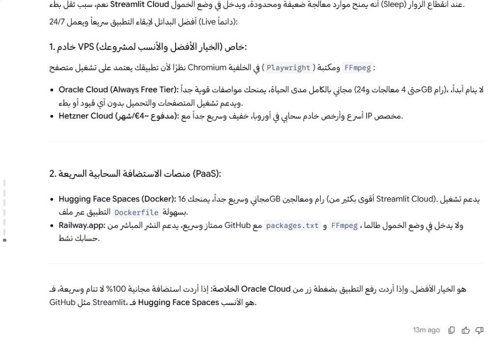
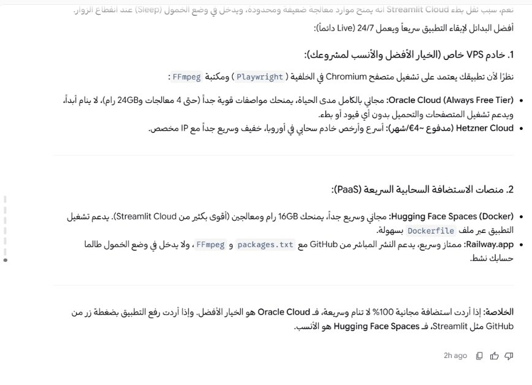

# Antigravity RTL & BiDi Fix

A lightweight utility to resolve Right-to-Left (RTL) text direction and English/Arabic mixed-text alignment issues in Google Antigravity's Agent Manager chat interface.

Also fully compatible with **Persian (Farsi)**, **Urdu**, **Pashto**, **Kurdish**, and any language using the Arabic script.

---

## 📸 Preview / معاينة النتيجة

| Before (قبل الإصلاح) ❌ | After (بعد الإصلاح) ✅ |
| :---: | :---: |
|  |  |
| *محاذاة خاطئة، علامات ترقيم وأقواس مقلوبة، وتداخل مشوه للكلمات الإنجليزية*<br>*Mangled punctuation, reversed brackets, and broken mixed-text alignment* | *محاذاة كاملة لليمين، علامات ترقيم سليمة، وتناسق انسيابي تام للنصوص المختلطة*<br>*Clean RTL direction, correct punctuation, and proper BiDi rendering* |

---

## Language / اللغة

- [English Documentation](#english)
- [التوثيق باللغة العربية](#arabic)

---

<a name="english"></a>
## English

### Key Features
1. **Targeted Scope**: Modifies only the Antigravity chat window (`Agent Manager`). Does not alter the separate code editor (`Antigravity IDE` / Monaco Editor).
2. **List Markers Fixed**: Numbers (`1.`, `2.`) and bullet points (`•`) properly align to the right edge for RTL languages, and stay on the left for LTR languages.
3. **Code Safety**: Preserves code blocks (`pre`, `code`) in strict Left-to-Right (`direction: ltr`) layout.
4. **Safety & Rollback**: Automatically creates an unpatched backup (`app.asar.backup`) before any file modification. Includes a 1-click restore feature.
5. **Idempotent**: Safe to run repeatedly; detects existing installations and updates automatically without duplicate code injection.

### Requirements
- Windows 10 / 11
- Python 3.8 or newer (ensure "Add python.exe to PATH" is checked during installation)

### 📥 Download & Installation

> **Note**: You can run this tool from **any location on your computer** (Desktop, Downloads, etc.). The script automatically detects the Antigravity installation path. The only requirement is that `antigravity_rtl_fix.py` and `Run_RTL_Fix.bat` remain together in the same folder.

#### Option 1: Direct Download (Recommended — No Git Required)
1. **[Click here to Download ZIP](https://github.com/evile92/antigravity-rtl-fix/archive/refs/heads/main.zip)** (or click the green **Code** button at the top of the repository page and select **Download ZIP**).
2. Extract the downloaded `.zip` file anywhere on your computer.
3. Fully exit Antigravity (right-click the Antigravity tray icon near your clock and click **Quit**).
4. Double-click **`Run_RTL_Fix.bat`**.
5. Choose option **`2`** to apply the fix.
6. Relaunch Antigravity.

#### Option 2: Using Git Clone
```bash
git clone https://github.com/evile92/antigravity-rtl-fix.git
cd antigravity-rtl-fix
Run_RTL_Fix.bat
```
Choose option **`2`** to apply the fix.

### Rollback / Uninstall
To revert to the stock version at any time:
1. Close Antigravity completely.
2. Run **`Run_RTL_Fix.bat`**.
3. Choose option **`3`** to restore the original backup.

### ⚠️ Important Note About Antigravity Updates
Whenever **Antigravity** installs an official update, its updater replaces `resources\app.asar` with a fresh unpatched copy for the new version. This will revert the chat UI back to the default layout.
- To restore RTL support after any Antigravity update, simply run **`Run_RTL_Fix.bat`** again and choose option **`2`**. The script will automatically refresh the backup for the new version and re-apply the fix.

---

<a name="arabic"></a>
## العربية

أداة لإصلاح اتجاه النصوص العربية واللغات المكتوبة بالحرف العربي (الفارسية، الأردية، الكردية، البشتو، وغيرها) داخل واجهة المحادثة في برنامج Antigravity.

### المميزات الرئيسية
1. **نطاق محدد وآمن**: يستهدف واجهة المحادثة فقط (`Agent Manager`) دون المساس بملفات محرر الأكواد (`Antigravity IDE`).
2. **إصلاح ترقيم ونقاط القوائم**: نقل الترقيم والنقاط إلى جهة اليمين للنصوص العربية، مع إبقائها على اليسار للقوائم الإنجليزية.
3. **حماية الأكواد البرمجية**: إبقاء كتل وأسطر الكود (`pre`, `code`) من اليسار لليمين (`LTR`).
4. **نسخ احتياطي واستعادة بضغطة زر**: إنشاء نسخة احتياطية تلقائية (`app.asar.backup`) وإمكانية التراجع في أي وقت.
5. **عدم التكرار**: فحص مسبق لمنع تكرار الحقن والتحديث الذكي عند تثبيت إصدار أحدث.

### المتطلبات
- نظام تشغيل Windows 10 أو Windows 11.
- تثبيت بايثون (Python 3.8+) مع تفعيل خيار `Add python.exe to PATH`.

### 📥 خطوات التحميل والتثبيت

> **مكان وجود الملفات**: يمكنك تشغيل الأداة من **أي مسار على جهازك** (سطح المكتب، التنزيلات، أو أي مجلد). السكريبت يبحث تلقائياً عن مسار تثبيت برنامج Antigravity في النظام. الشرط الوحيد هو أن يكون الملفان (`antigravity_rtl_fix.py` و `Run_RTL_Fix.bat`) معاً داخل نفس المجلد.

#### الطريقة الأولى: تحميل مباشر بدون Git (الأسهل والمفضلة)
1. **[اضغط هنا لتحميل الأداة مباشرة بصيغة ZIP](https://github.com/evile92/antigravity-rtl-fix/archive/refs/heads/main.zip)** (أو اضغط على زر **Code** الأخضر في أعلى صفحة المستودع ثم اختر **Download ZIP**).
2. فك الضغط عن الملف في أي مكان تريده على جهازك.
3. تأكد من إغلاق برنامج Antigravity بالكامل (من شريط المهام بجانب الساعة: كليك يمين ثم **Quit**).
4. شغل الملف **`Run_RTL_Fix.bat`**.
5. اختر الرقم **`2`** لتطبيق الإصلاح.
6. أعد تشغيل برنامج Antigravity وستجد النصوص منسقة ومضبوطة بالكامل.

#### الطريقة الثانية: عبر Git Clone (للمطورين)
```bash
git clone https://github.com/evile92/antigravity-rtl-fix.git
cd antigravity-rtl-fix
Run_RTL_Fix.bat
```
ثم اختر الرقم **`2`** لتطبيق الإصلاح.

### التراجع والاستعادة
1. إغلاق Antigravity بالكامل.
2. تشغيل **`Run_RTL_Fix.bat`**.
3. اختيار الرقم **`3`** لاسترجاع النسخة الأصلية فوراً.

### ⚠️ ملاحظة مهمة عند تحديث برنامج Antigravity
عند قيام برنامج **Antigravity** بتنزيل وتثبيت أي تحديث رسمي جديد، يقوم نظام التحديث باستبدال ملف `resources\app.asar` بالكامل بنسخة جديدة ونظيفة تخص الإصدار الجديد، مما يؤدي إلى اختفاء تعديل الاتجاه (RTL) وعودة الواجهة لوضعها الافتراضي.
- **الحل:** بعد أي تحديث للبرنامج، ما عليك سوى تشغيل **`Run_RTL_Fix.bat`** مجدداً واختيار الرقم **`2`**، وسيقوم السكريبت تلقائياً بتحديث النسخة الاحتياطية للإصدار الجديد وإعادة تطبيق الإصلاح في ثوانٍ.
